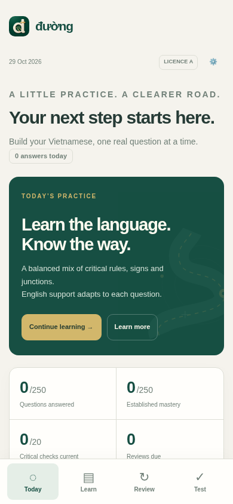

# Đường · Vietnam motorcycle theory practice

[**Open the free app →**](https://mahmoud-ashraf98.github.io/A2-license-practice-Vietnam/)

Learning to ride in Vietnam when you don’t read much Vietnamese is hard. Đường helps you understand the language and rules behind the motorcycle theory questions, then practise answering in Vietnamese with less help.

**No account, subscription or app-store download.** Works on phones, tablets and computers. Progress is saved in your browser, with offline practice and downloadable backups.



## Start here

1. [Open Đường](https://mahmoud-ashraf98.github.io/A2-license-practice-Vietnam/) in your browser.
2. Choose **A or A1**, your exam date if you know it, and realistic daily study time. You can skip setup and change it later.
3. Use **Continue learning** for a mix of critical rules, signs, junctions and other topics. New questions can start bilingual; familiar questions start with less help.
4. After a mistake, try a focused repair or practise the linked phrases, then return to the same question. Come back another day for a Vietnamese-only check.
5. Try **Test** when you want a strict timed mock or an untimed practice paper. Mark “Unsure” or “Guessed” before submitting if useful, then use **Repair this paper**.

The daily target is a recommendation. **Learn more** is always available. A deadline can raise the recommended workload; it cannot guarantee that the available study time is enough.

## A, A1 and the older “A2” name

The GitHub repository still uses **A2**, an older licence-category name. The supplied motorcycle bank and exam profiles cover **A/A1**. Confirm the category you need, your eligibility, documents, test language and local examination arrangements with a licensed driving school or test centre. This app does not arrange licensing, assess eligibility or replace practical riding instruction.

The bundled **current-format profile is verified through 28 February 2027, Vietnam time**:

| Profile | Questions | Time | Minimum correct | Critical rule |
| --- | ---: | ---: | ---: | --- |
| A | 25 | 19 minutes | 23/25 | Wrong or blank critical answer fails |
| A1 | 25 | 19 minutes | 21/25 | Wrong or blank critical answer fails |

Each mock contains exactly one motorcycle-critical question. Its mix includes eight non-critical road-rule questions, one critical question, one culture question, one technique question, eight sign questions and six junction questions. The original answer-choice order is preserved.

**From 1 March 2027, these profiles become archived study material.** The app disables their mocks until a replacement bank and profile are verified. Choosing a later exam date does not extend this bank’s validity. Confirm current requirements with your test centre.

## What you can practise

- **250 official Vietnamese questions**, 790 choices, the exact 20 motorcycle-critical items, and 128 original source figures across 127 questions.
- **Four English-support levels:** bilingual, English on request, phrase help, and Vietnamese only. Recommendations adapt to each question; you can adjust them.
- **93 Vietnamese phrases**, a finite daily queue, Vietnamese-to-English meaning checks, locating chunks in authentic sentences, sentence interpretation and optional reverse practice.
- Inline glosses, reading breakdowns, personal saved spans and contextual repair that keeps your original question and place.
- Separate teaching activities for negatives, numbers, signs and junctions, including the maximum/minimum speed distinction in question 362 and the vehicle order in question 487.
- Saved study sessions and papers, due reviews, bookmarks, optional uncertainty flags, paper repair, JSON backup import/export and a restore point before the last import.

Official question numbers have gaps because this is a subset of the 600-question book. A paper’s **Question 1 of 25** is its position; the smaller **Bank ID** is the original source number.

## Scores, confidence and learning progress

Exam scores follow the selected profile. Blank answers stay incorrect in a paper but do not count as answered-question coverage or consume your new-learning allowance. Diagnostic mocks do not replace teaching new content.

Confidence is optional. An unprovided rating stays **unrated**; a correct mock answer never invents “Sure.” English, phrase help and reading guidance are recorded separately. Correct assisted revision preserves established mastery; a later error or explicit uncertainty asks for a recheck.

The app’s mastery recommendation requires three confident, unaided correct answers on different Vietnam-local days, including a gap of at least three days. After seeing an answer or translation, an immediate retry is useful repair; a **24-hour delay** is required before it can count as cold recall. Switching support or reloading cannot erase that exposure.

Current readiness evidence also asks for no overdue question reviews, critical checks within seven days, with none overdue, and ten strong strict mocks within 14 days across at least three days. These are **transparent study recommendations, not legal requirements or a probability of passing**. Historical scores remain available.

Older saved scores are preserved. Previously inferred exam confidence is retained as an audit field and migrated to unrated. See [learning rules and migration](docs/learning-rules.md).

## Install and use offline

- **Android / Chrome:** open the app, then use the browser menu’s **Install app** or **Add to Home screen** option.
- **iPhone / iPad / Safari:** use **Share → Add to Home Screen**.
- You can also keep using it as a normal website.

While connected, leave the app open until **Settings & backups → Offline practice** says **Ready offline**. It downloads and checks the app, questions, diagrams and source PDFs, about 21 MB. Open the app once in airplane mode before relying on it away from a connection.

Updates download and verify in the background. Refresh while connected to load the new version; closing every app window or clearing browser data is unnecessary. Open pages are never automatically reloaded, and saved study sessions, paper answers and deadlines resume after a refresh. A strict paper’s clock continues while the app is in the background or closed; reloading does not restart it.

Phrase audio is optional and depends on an installed Vietnamese browser voice. Slow and normal playback are available when supported. Reading practice works without audio; there is no guaranteed bundled audio fallback.

## Keep your progress safe

There is no login or cloud sync. Learning records stay on the **browser and device where you study**. Clearing site data, changing browsers or private browsing can lose that local copy.

Use **Settings & backups → Export JSON backup** regularly. The app shows your last export date and reminds you after substantial progress. To move devices, transfer that file and use **Import a backup**. Review the preview before merging; **Restore before last import** keeps a local recovery point. Keep backup files private if you do not want to share your learning history.

The app has no analytics, advertising or application backend. GitHub Pages serves the files and may process normal hosting request information.

## Sources and translation limits

Vietnamese questions, keyed answer IDs, option order, critical flags and diagrams are retained from the supplied official-source audit. **English translations, explanations and teaching activities are AI-authored support, not an official English translation or independently human-certified legal advice.** Source wording and keys remain authoritative.

Source-specific cautions remain visible, including questions 44, 124, 260, 377 and 432. Do not generalise an unusual keyed item into a universal road rule.

- [Government guidance on the question bank and motorcycle paper structure](https://xaydungchinhsach.chinhphu.vn/huong-dan-su-dung-bo-600-cau-hoi-dung-de-sat-hach-lai-xe-co-gioi-duong-bo-119250513110514585.htm)
- [Government explanation of changes and the March 2027 transition](https://xaydungchinhsach.chinhphu.vn/nhung-diem-moi-trong-sat-hach-lai-xe-119260703113320777.htm)
- [Bundled official question book](https://mahmoud-ashraf98.github.io/A2-license-practice-Vietnam/sources/official_600_questions.pdf) · [Guidance 2262](https://mahmoud-ashraf98.github.io/A2-license-practice-Vietnam/sources/official_guidance_2262.pdf)

## Report a problem or contribute

[Open a GitHub issue](https://github.com/Mahmoud-Ashraf98/A2-license-practice-Vietnam/issues) with the bank question number, what seems wrong, your device/browser and, for content corrections, a source reference. Avoid including your backup or other private information in a public issue. Translation and native-Vietnamese review are especially welcome.

## Run locally

The app is plain HTML, CSS and JavaScript modules, with no production dependencies or build step. Use a recent Node.js version for tests and Python 3 for the local server and offline packaging:

```bash
git clone --branch gh-pages https://github.com/Mahmoud-Ashraf98/A2-license-practice-Vietnam.git
cd A2-license-practice-Vietnam
npm start
# Open http://localhost:8000
```

```bash
npm test                 # focused learning, migration and paper-composition checks
npm run package:offline  # regenerate checksums after changing shipped files
npm run check            # syntax and complete offline-manifest verification
```

For browser checks, install Python Playwright (`python3 -m pip install playwright`), install Chromium (`python3 -m playwright install chromium`), then run `npm run test:browser`. You can use a system browser with `CHROMIUM_PATH=/usr/bin/chromium`. See [validation and device limitations](docs/validation.md).

The app is served from the root of **`gh-pages`** by GitHub Pages. `main` contains the repository’s shareable README. Source changes belong on `gh-pages`; update the offline manifest before publishing.

Code is available under the [MIT licence](LICENSE). Official source documents and question material retain their original attribution; the code licence does not relicense third-party material.
